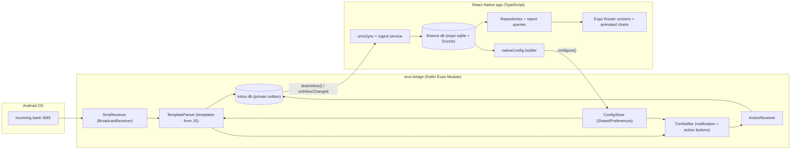
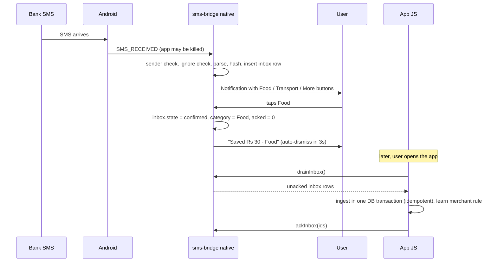
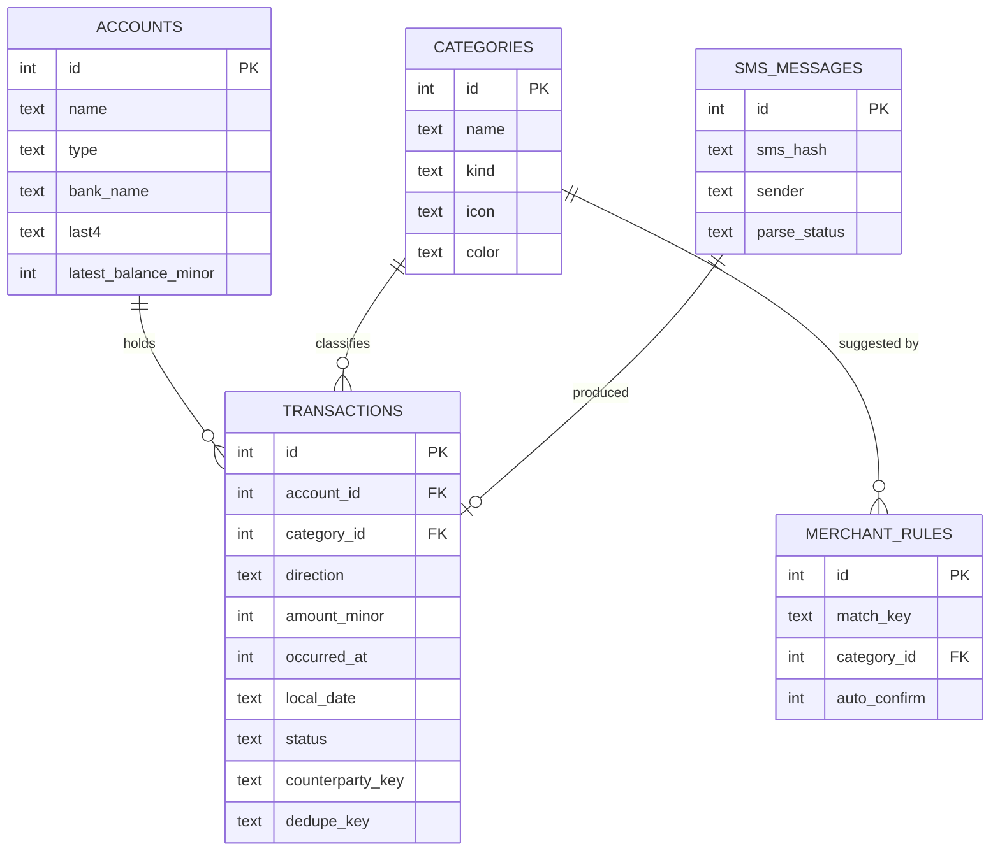

# Personal Finance Tracker — Architecture & Build Spec

> **Audience:** an AI coding agent that will build this app end-to-end.
> **Owner/user:** a single person, personal use, India (INR), Android phone.
> **Spec date:** 11 Oct 2026. Latest stable Expo SDK at spec time: **SDK 57** (React Native 0.86). SDK 58 is in beta. Do **not** use the beta.

---

## 0. How to use this document

1. Read sections 1–3 fully before writing code. Section 2 lists decisions that differ from a naive approach. They are deliberate.
2. Build in the order of **Section 18 (phases)**. Phase 0 contains a *risk spike* (SMS received while app is killed → notification with buttons). Do it first. If it fails, stop and report. Nothing else matters without it.
3. Do **not** copy library versions from this document. Create the project with the latest SDK 57 template and install packages with `npx expo install <pkg>` so versions match the SDK. Read each library's current docs before using it.
4. If something in this spec is impossible or wrong on the real toolchain, **stop and report the problem with a proposed alternative** instead of silently deviating.
5. Working rules: TypeScript strict mode; no `any` in domain code; **money is never a float** (see §8.1); write unit tests for parser, money utils and report queries; commit at the end of each phase.

---

## 1. Product summary

A private, offline, single-user expense and income tracker.

**Core promise:** when a bank SMS arrives (UPI payment, credit, bank charge), the user instantly gets a notification: *"₹30.00 debited — add as expense?"* with category buttons. One tap saves the entry with the amount already extracted from the SMS. No manual typing.

**Must-have features**
- F1. Read incoming bank SMS (even when the app is closed), extract amount, direction (debit/credit), counterparty, reference, date, account suffix, balance.
- F2. Notification with **category action buttons**; saving happens from the notification itself.
- F3. Manual entry: amount, debit/credit, category, date, note.
- F4. Categories (food, books, rent, recharge, …) — user-editable.
- F5. History: list by date, filter by category/account/type/date range/search.
- F6. Insights: **week-wise, month-wise, year-wise** totals; income vs. expense; category breakdown with **animated pie/donut, bar and line charts**.
- F7. **Month-end summary:** total received, total spent, net, spend by category, top payees, comparison with last month.

**Non-goals (v1):** iOS, cloud sync, multi-user, bank APIs / Account Aggregator, Play Store release, investments tracking, receipt OCR.

---

## 2. Key decisions (and where they differ from the original idea)

| # | Decision | Why |
|---|---|---|
| D1 | **Android only.** | iOS does not allow apps to read SMS. |
| D2 | **Expo "development build" + a custom local Expo native module (Kotlin). Expo Go cannot be used.** | Expo has no SMS-reading API (`expo-sms` only *sends*). Community packages for Expo SMS reading are small/alpha and run only while the JS runtime is alive. Reliability requires our own module. Expo still gives us the toolchain, SQLite, router, EAS builds. |
| D3 | **SMS capture, parsing, and notification are done natively in Kotlin**, not in JavaScript. | When the app is swiped away, there is no JS runtime. A manifest-declared `BroadcastReceiver` is woken by Android for `SMS_RECEIVED`; native code can parse and post the notification instantly (~ms) without booting React Native. |
| D4 | **Parser templates are data (JSON/regex) owned by TypeScript and pushed to native.** Both TS and Kotlin execute the *same* templates. | One source of truth. New bank formats = add a template, no Kotlin change. |
| D5 | **"Outbox" sync pattern.** Native keeps a small private `inbox` table; JS drains it into the main ledger on app open / event. The main DB has a **single writer (JS)**. | Avoids two processes writing one SQLite file, avoids migration coupling, is idempotent and crash-safe. |
| D6 | **Notification shows up to 3 buttons: `[Smart cat 1] [Smart cat 2] [More…]`.** Not a full category picker. | Android displays at most 3 notification actions; a notification cannot host a scrollable picker. Buttons are chosen by learned merchant rules, then by most-used categories. "More…" opens a quick-categorize sheet in the app. |
| D7 | **Reports count only `confirmed` transactions.** SMS-detected items start as `pending` and are excluded until the user confirms (or an auto-confirm rule fires). | The user asked "do you want to add it?" — so some SMS will be declined (ignored). |
| D8 | **Money is stored as integer minor units (paise).** | No floating point errors. |
| D9 | **Distribution is sideload (APK), not Play Store.** | Play Store restricts SMS permissions heavily. Consequence: see D10. |
| D10 | **Sideloaded apps on Android 15/16 treat SMS permissions as "restricted".** The permission dialog may be refused until the user opens *Settings → Apps → (app) → ⋮ → Allow restricted settings* and then grants SMS. The option appears only after a first blocked attempt. | The onboarding screen **must** detect this case and show step-by-step instructions (§14). |
| D11 | **Charts: Victory Native (Skia-based) + Reanimated.** Fallback: `react-native-gifted-charts` if Victory causes build/compat trouble. | We already need a dev build, so Skia is no extra cost; gives smooth GPU animations. |
| D12 | **Data layer: `expo-sqlite` + Drizzle ORM** (typed schema + migrations). Reports use raw SQL via Drizzle's `sql` helper. | Typed, migratable, no extra native deps. |

---

## 3. Tech stack

| Concern | Choice |
|---|---|
| Framework | Expo SDK 57, React Native (New Architecture — default), TypeScript strict |
| Build | `expo-dev-client`, local `npx expo run:android` for dev; EAS Build (or local Gradle) for release APK |
| Navigation | Expo Router (file-based) |
| Database | `expo-sqlite` (WAL mode, `PRAGMA foreign_keys=ON`) + `drizzle-orm` + `drizzle-kit` (migrations) |
| Native SMS | Local Expo Module `modules/sms-bridge` (Kotlin, Expo Modules API) |
| Notifications | Native (Kotlin `NotificationCompat`) for transaction prompts; `expo-notifications` only for permission helper and month-end scheduled notification |
| State | Zustand for UI state (selected period, filters, `dbVersion` tick). Data via repository functions + hooks |
| Lists | `@shopify/flash-list` |
| Charts | `victory-native` + `@shopify/react-native-skia` + `react-native-reanimated` + `react-native-gesture-handler` |
| Dates | `date-fns` (week starts Monday; configurable) |
| Validation | `zod` for forms and for native↔JS payloads |
| Misc | `expo-haptics`, `expo-sharing`, `expo-file-system`, `expo-local-authentication` (optional app lock), `react-native-view-shot` (optional share card) |
| Tests | Jest (+ `jest-expo`), `better-sqlite3` for SQL/report tests in Node, JUnit for Kotlin parser |

---

## 4. System architecture



### 4.1 Real-time flow (app killed)



### 4.2 Sync protocol (native ↔ JS) — rules the agent must follow

1. Every native inbox row has `acked` (0/1). Native sets `acked=0` on insert **and on any state change** (e.g., user taps a notification button after JS already acked the pending row).
2. JS calls `drainInbox()` on: app start, every `AppState → active`, and on native event `onInboxChanged`. It ingests all rows in **one DB transaction**, then calls `ackInbox(ids)`.
3. Ingest is **idempotent**, keyed by `sms_messages.sms_hash` and `transactions.dedupe_key`.
4. Conflict rule: if the ledger row is already `confirmed` or `ignored`, the ledger wins. A `pending` ledger row can be upgraded by an incoming `confirmed`/`ignored` state.
5. When the user resolves an item inside the app, JS calls `cancelNotification(smsHash)` so a stale notification does not linger.
6. Native purges acked inbox rows older than 30 days.

---

## 5. Repository layout

```
finance-tracker/
├─ app/                          # Expo Router
│  ├─ _layout.tsx                # providers, migrations gate, native sync bootstrap
│  ├─ onboarding.tsx
│  ├─ (tabs)/
│  │  ├─ _layout.tsx             # bottom tabs + center "+" button
│  │  ├─ index.tsx               # Home / Dashboard
│  │  ├─ transactions.tsx
│  │  ├─ insights.tsx
│  │  └─ settings.tsx
│  ├─ transaction/new.tsx        # manual add (modal)
│  ├─ transaction/[id].tsx       # view/edit
│  ├─ review/index.tsx           # "Needs review" inbox (pending items)
│  ├─ review/[id].tsx            # quick-categorize sheet (deep link target from notification)
│  ├─ summary/[month].tsx        # month-end summary (YYYY-MM)
│  ├─ categories/index.tsx
│  ├─ categories/[id].tsx
│  ├─ accounts/index.tsx
│  └─ debug/unparsed.tsx         # list of SMS that matched sender but not any template
├─ src/
│  ├─ db/ (client.ts, schema.ts, seed.ts, migrations/)
│  ├─ repositories/ (transactions.ts, categories.ts, accounts.ts, rules.ts, reports.ts, settings.ts)
│  ├─ services/
│  │  ├─ parser/ (templates.ts, parse.ts, normalize.ts)
│  │  ├─ smsSync.ts              # drain, ack, backfill
│  │  ├─ ingest.ts               # parsed SMS → ledger rows (idempotent)
│  │  ├─ nativeConfig.ts         # builds ParserConfig from DB, pushes to native
│  │  ├─ monthEnd.ts             # schedules month-end notification
│  │  └─ exportData.ts           # CSV + DB file export / restore
│  ├─ hooks/                     # useMonthSummary, useCategoryBreakdown, ...
│  ├─ components/ (ui/, charts/, transaction/, review/)
│  ├─ store/ (uiStore.ts)        # period, filters, dbVersion
│  ├─ theme/ (tokens.ts, useTheme.ts)
│  └─ utils/ (money.ts, dates.ts)
├─ modules/sms-bridge/           # LOCAL EXPO MODULE (all Kotlin lives here, never in /android)
│  ├─ expo-module.config.json
│  ├─ src/index.ts               # typed JS API
│  └─ android/
│     ├─ build.gradle
│     └─ src/main/
│        ├─ AndroidManifest.xml  # permissions + receivers (merged automatically)
│        └─ java/expo/modules/smsbridge/
│           ├─ SmsBridgeModule.kt
│           ├─ SmsReceiver.kt
│           ├─ NotificationActionReceiver.kt
│           ├─ TemplateParser.kt
│           ├─ TxnNotifier.kt
│           ├─ InboxDb.kt
│           ├─ ConfigStore.kt
│           └─ SmsInboxReader.kt
├─ fixtures/sms.json             # shared test fixtures used by Jest AND JUnit
└─ drizzle.config.ts
```

> `android/` is generated by `expo prebuild` and may be regenerated at any time. **Never hand-edit it.** Keep all native code and manifest entries inside `modules/sms-bridge`.

---

## 6. Native module `sms-bridge` (Kotlin)

Scaffold with `npx create-expo-module@latest --local sms-bridge`, then implement the following.

### 6.1 Manifest (module-level `AndroidManifest.xml`)

- Permissions: `RECEIVE_SMS`, `READ_SMS`, `POST_NOTIFICATIONS`.
- `SmsReceiver`: `exported="true"`, `android:permission="android.permission.BROADCAST_SMS"`, intent-filter `android.provider.Telephony.SMS_RECEIVED` with priority 999.
- `NotificationActionReceiver`: `exported="false"`.

### 6.2 Components

**`SmsReceiver`**
- Use `Telephony.Sms.Intents.getMessagesFromIntent(intent)`. **Concatenate multipart messages** from the same `originatingAddress`.
- Use `goAsync()`; do the work on a background thread; call `finish()` in `finally`. Must complete well inside the ~10 s limit.
- Pipeline: sender passes `monitoredSenderPatterns` → body does not match any `ignorePatterns` → `TemplateParser.parse()` → compute `smsHash` → insert into `inbox` (ignore if hash exists) → apply rules → notify.
- Messages from monitored senders that match **no template**: store in `inbox` with `parsed_json = NULL` and **do not notify** (JS will list them in `debug/unparsed`).
- Never log SMS bodies in release builds.

**`TemplateParser`** — executes templates from `ParserConfig` (see §7). Must use `BigDecimal`/string math for amounts, never `Double`. Java named-group names must match `[a-zA-Z][a-zA-Z0-9]*` (no underscores). `matcher.group(name)` throws if the group does not exist in that pattern — wrap each field extraction in try/catch.

**`InboxDb`** — own `SQLiteOpenHelper` DB `inbox.db`:

```sql
CREATE TABLE inbox (
  id           INTEGER PRIMARY KEY AUTOINCREMENT,
  sms_hash     TEXT NOT NULL UNIQUE,      -- SHA-256 hex of trimmed body
  sender       TEXT NOT NULL,
  body         TEXT NOT NULL,
  received_at  INTEGER NOT NULL,          -- epoch ms
  parsed_json  TEXT,                      -- null if no template matched
  state        TEXT NOT NULL DEFAULT 'pending'
               CHECK (state IN ('pending','confirmed','auto_confirmed','ignored')),
  category_id  INTEGER,                   -- chosen category (ledger category id)
  acked        INTEGER NOT NULL DEFAULT 0,
  created_at   INTEGER NOT NULL,
  resolved_at  INTEGER
);
CREATE INDEX ix_inbox_acked ON inbox(acked);
```

**`TxnNotifier`**
- Channels: `txn_review` (importance HIGH) for prompts; `txn_saved` (importance LOW) for "Saved" confirmations.
- Notification id = inbox row id. Group key `txn`.
- **Debit:** title `₹30.00 debited — add as expense?`; text `Vikas Munshilal · Equitas ••2825 · Bal ₹864.45`.
- **Credit:** title `₹2,500.00 received — add as income?`; text `SANYOG NANASAH · Equitas ••2825`.
- Missing counterparty (bank charge): use the description (`SMS ALRT CHGS+GST`).
- **Actions (max 3):**
  1. Best-guess category (rule match → else most-used #1 for that direction)
  2. Second suggestion (most-used #2; skip if identical to #1)
  3. `More…` → `PendingIntent.getActivity` with deep link `financetracker://review/<smsHash>`
- Tapping the notification body also opens the same deep link.
- Category buttons are `PendingIntent.getBroadcast` → `NotificationActionReceiver` (no activity trampolines — Android 12+ forbids them). Use `FLAG_IMMUTABLE | FLAG_UPDATE_CURRENT` and **unique request codes** per (row, action).
- **Lock-screen privacy:** `VISIBILITY_PRIVATE` with a `publicVersion` that says "New bank transaction" without the amount.
- After a category action: update inbox row (`state='confirmed'`, `category_id`, `acked=0`), replace the notification with `txn_saved` text `Saved ₹30.00 · Food ✓` using `setTimeoutAfter(3000)`, emit `onInboxChanged` if the JS runtime is alive.
- **Auto-confirm:** if a matching rule has `autoConfirm=true`, skip the prompt: save as `auto_confirmed` and post only a silent `txn_saved` notification (user setting can disable even that).

**`SmsInboxReader`** — reads `content://sms/inbox` for backfill and for the "pick your bank senders" onboarding step.

**`ConfigStore`** — persists the last `ParserConfig` JSON in `SharedPreferences` so native works when JS is not running.

### 6.3 JS API (`modules/sms-bridge/src/index.ts`)

```ts
export type QuickCategory = { id: number; name: string; emoji: string };

export type NativeRule = {
  match: 'exact' | 'contains';
  key: string;                         // normalized (see §7.4)
  direction: 'debit' | 'credit' | 'any';
  categoryId: number;
  autoConfirm: boolean;
};

export type ParserConfig = {
  version: number;                      // bump on any change
  monitoredSenderPatterns: string[];    // regex strings, case-insensitive, matched on sender address
  ignorePatterns: string[];             // regex strings; body match => ignore
  templates: ParserTemplate[];          // see §7.2
  quickCategories: { debit: QuickCategory[]; credit: QuickCategory[] }; // top 2 each, ordered
  rules: NativeRule[];
  promptNotificationsEnabled: boolean;
  silentConfirmationsEnabled: boolean;
};

export type ParsedTxn = {
  templateId: string;
  direction: 'debit' | 'credit';
  amountMinor: number;                  // paise, integer
  accountLast4: string | null;
  reference: string | null;
  counterparty: string | null;
  description: string | null;
  channel: 'upi' | 'other';
  txnDate: string;                      // 'YYYY-MM-DD' (from body)
  balanceAfterMinor: number | null;
  lowConfidence: boolean;
};

export type InboxItem = {
  id: number; smsHash: string; sender: string; body: string; receivedAt: number;
  parsed: ParsedTxn | null;
  state: 'pending' | 'confirmed' | 'auto_confirmed' | 'ignored';
  categoryId: number | null;
};

export type RawSms = { smsHash: string; sender: string; body: string; receivedAt: number };

export function configure(config: ParserConfig): Promise<void>;
export function drainInbox(): Promise<InboxItem[]>;
export function ackInbox(ids: number[]): Promise<void>;
export function readSmsInbox(sinceEpochMs: number, limit: number): Promise<RawSms[]>;
export function cancelNotification(smsHash: string): Promise<void>;
export function getSystemState(): Promise<{
  receiveSms: boolean; readSms: boolean; notifications: boolean; batteryOptimizationIgnored: boolean;
}>;
export function openAppSettings(): void;               // app details page (restricted settings lives here)
export function openBatteryOptimizationSettings(): void;
export function debugInjectSms(sender: string, body: string): Promise<void>; // only works in debug builds
export function addInboxListener(cb: () => void): { remove(): void }; // event: onInboxChanged
```

Runtime permissions (`RECEIVE_SMS`, `READ_SMS`, `POST_NOTIFICATIONS`) are requested from JS with React Native's `PermissionsAndroid`.

---

## 7. SMS parsing specification

### 7.1 Reference messages (these are the acceptance fixtures — they MUST parse exactly as shown)

```
(1) INR 6.73 has been debited from Equitas A/c 2825 towards SMS ALRT CHGS+GST:300926/263641980 on 02-10-26. Avl Bal is INR 94.45.
(2) INR 2,500.00 credited via UPI to Equitas A/c 2825 -Ref:867186099240 on 11-10-26 from SANYOG NANASAH. Avl Bal is INR 3,364.45.
(3) INR 30.00 debited from Equitas-2825 via UPI -Ref:627951725402 to Vikas Munshilal on 06-10-26.Bal INR 864.45.Not U?SMS BLOCK UPI to 7045030000
```

| # | direction | amountMinor | last4 | reference | counterparty | description | channel | txnDate | balanceAfterMinor |
|---|---|---|---|---|---|---|---|---|---|
| 1 | debit | 673 | 2825 | null | null | `SMS ALRT CHGS+GST:300926/263641980` | other | 2026-10-02 | 9445 |
| 2 | credit | 250000 | 2825 | `867186099240` | `SANYOG NANASAH` | null | upi | 2026-10-11 | 336445 |
| 3 | debit | 3000 | 2825 | `627951725402` | `Vikas Munshilal` | null | upi | 2026-10-06 | 86445 |

Store these as `fixtures/sms.json` (message + expected parse). **Both Jest (TS parser) and JUnit (Kotlin parser) must run the same fixtures.** Add more fixtures whenever a new format is added.

### 7.2 Template format

```ts
type ParserTemplate =
  | {
      id: string;                       // e.g. 'equitas-debit-v1'
      mode: 'full';                     // one regex with named groups
      bankName: string;                 // e.g. 'Equitas'
      senderMatch?: string;             // optional extra sender regex
      direction: 'debit' | 'credit';
      pattern: string;                  // Java- and JS-compatible regex source
      flags: 'i' | '';                  // only 'i' supported
      dateFormat: 'dd-MM-yy' | 'dd-MM-yyyy' | 'dd/MM/yy' | 'dd-MMM-yy';
      // Named groups used: amt, acct, ref, payee, desc, date, bal  (all optional except amt, date)
      // channel = 'upi' if group `ref` is non-empty, else 'other'
    }
  | {
      id: string;                       // e.g. 'generic-v1'
      mode: 'fields';                   // independent extractors, for unknown formats (lowConfidence = true)
      bankName: string;
      fields: Partial<Record<'amt' | 'acct' | 'ref' | 'payee' | 'bal' | 'date', string>>; // each regex: group 1 = value
      debitKeywords: string[];
      creditKeywords: string[];
      dateFormats: string[];
    };
```

Templates are evaluated in order; first match wins. Put `full` templates first and `generic-v1` last.

### 7.3 Seed templates (Equitas)

Written as TS `String.raw` values. Group names are Java-safe.

```ts
export const EQUITAS_DEBIT = {
  id: 'equitas-debit-v1', mode: 'full', bankName: 'Equitas', direction: 'debit', flags: 'i',
  dateFormat: 'dd-MM-yy',
  pattern: String.raw`^INR\s(?<amt>[\d,]+\.?\d*)\s(?:has been\s)?debited\sfrom\sEquitas(?:\sA\/c\s|-)(?<acct>\d{3,4})\s(?:via\sUPI\s-?Ref:(?<ref>\d+)\sto\s(?<payee>.+?)|towards\s(?<desc>.+?))\son\s(?<date>\d{2}-\d{2}-\d{2})\.\s?(?:Avl\s)?Bal(?:\sis)?\sINR\s(?<bal>[\d,]+\.?\d*)`,
} as const;

export const EQUITAS_CREDIT = {
  id: 'equitas-credit-v1', mode: 'full', bankName: 'Equitas', direction: 'credit', flags: 'i',
  dateFormat: 'dd-MM-yy',
  pattern: String.raw`^INR\s(?<amt>[\d,]+\.?\d*)\scredited(?:\svia\sUPI)?\sto\sEquitas(?:\sA\/c\s|-)(?<acct>\d{3,4})\s-?Ref:(?<ref>\d+)\son\s(?<date>\d{2}-\d{2}-\d{2})\sfrom\s(?<payee>.+?)\.\s?(?:Avl\s)?Bal(?:\sis)?\sINR\s(?<bal>[\d,]+\.?\d*)`,
} as const;
```

Patterns are intentionally **not anchored at the end**: trailing text such as `Not U?SMS BLOCK UPI to 7045030000` is ignored.

**`generic-v1` fallback** (fields mode) — reasonable starting extractors; refine with tests:

```
amt   : (?:INR|Rs\.?|₹)\s?([\d,]+(?:\.\d{1,2})?)
acct  : (?:A\/c|a\/c|ac|account)[\s\-]*(?:no\.?)?\s*[Xx*]*(\d{3,4})
ref   : (?:Ref(?:erence)?(?:\s?No\.?)?|UTR|RRN)[:\s\-]*([A-Za-z0-9]{6,})
bal   : (?:Avl\.?\s*)?Bal(?:ance)?(?:\s*is)?[:\s]*(?:INR|Rs\.?|₹)\s?([\d,]+(?:\.\d{1,2})?)
debitKeywords : debited, spent, withdrawn, paid, sent
creditKeywords: credited, received, deposited
```
Results from `generic-v1` set `lowConfidence = true`; the notification title becomes `Check details: ₹X debited`.

**Default `ignorePatterns`** (must not match the 3 fixtures): `\bOTP\b`, `will be (debited|credited)`, `(collect|payment) request`, `minimum balance`, `statement`, `is due`.

### 7.4 Normalization & derived fields (implement identically in TS and Kotlin)

- **Counterparty key:** `lowercase → replace non [a-z0-9 ] with space → collapse whitespace → trim`. Example: `Vikas Munshilal` → `vikas munshilal`.
- **Amount → minor units:** strip commas, split on `.`, pad/truncate fraction to 2 digits, compute integer. No floating point.
- **smsHash:** SHA-256 hex of `body.trim()`.
- **`occurred_at`:** use the SMS received timestamp. If the date in the body differs from the local date of the received timestamp, use the body date at 12:00 local time. `local_date` is derived from the final `occurred_at` in device timezone.
- **dedupe key:** `ref:<reference>` when a reference exists, else `sms:<smsHash>`.
- **Sender IDs** (e.g., `AX-EQUTAS-S`) are not hard-coded. Onboarding lets the user pick senders (§11.1). Default patterns: `EQUTAS`, `EQUITAS`.

---

## 8. Data model (main DB `finance.db`, owned by JS)

### 8.1 Rules

- **Money:** `INTEGER` paise. Display with a formatter that implements **Indian digit grouping** (`12,34,567.00`). Do not rely on `Intl` alone (Hermes support varies); implement a tested fallback.
- **Dates:** `occurred_at` epoch ms (UTC) + `local_date` `'YYYY-MM-DD'` (device timezone at insert). **All grouping/filtering uses `local_date`.** Never `GROUP BY` on a converted epoch.
- **Reports count only** `status='confirmed'` and exclude categories with `kind='neutral'` (transfers).
- **Direction ↔ category kind validation** (in repository layer): `debit` → `expense` or `neutral` category; `credit` → `income` or `neutral`. `category_id IS NULL` is allowed and reported as "Uncategorized".
- **Soft-delete categories** via `is_archived`; hard delete only after reassigning their transactions.

### 8.2 ER diagram



### 8.3 DDL (implement the same in Drizzle `schema.ts` and generate migrations with drizzle-kit)

```sql
PRAGMA foreign_keys = ON;
PRAGMA journal_mode = WAL;

CREATE TABLE accounts (
  id                    INTEGER PRIMARY KEY AUTOINCREMENT,
  name                  TEXT NOT NULL,                          -- "Equitas ••2825"
  type                  TEXT NOT NULL DEFAULT 'bank'
                        CHECK (type IN ('bank','cash','wallet','credit_card')),
  bank_name             TEXT,
  last4                 TEXT,                                   -- matches SMS account suffix
  currency              TEXT NOT NULL DEFAULT 'INR',
  latest_balance_minor  INTEGER,                                -- from latest SMS "Avl Bal" (informational)
  latest_balance_at     INTEGER,
  is_archived           INTEGER NOT NULL DEFAULT 0,
  created_at            INTEGER NOT NULL
);
CREATE UNIQUE INDEX ux_accounts_bank_last4 ON accounts(bank_name, last4) WHERE last4 IS NOT NULL;

CREATE TABLE categories (
  id          INTEGER PRIMARY KEY AUTOINCREMENT,
  name        TEXT NOT NULL,
  kind        TEXT NOT NULL CHECK (kind IN ('expense','income','neutral')),
  icon        TEXT NOT NULL,                                    -- emoji
  color       TEXT NOT NULL,                                    -- hex, e.g. '#F97316'
  sort_order  INTEGER NOT NULL DEFAULT 0,
  is_system   INTEGER NOT NULL DEFAULT 0,                       -- cannot delete/rename (e.g. Transfer)
  is_archived INTEGER NOT NULL DEFAULT 0,
  created_at  INTEGER NOT NULL
);
CREATE UNIQUE INDEX ux_categories_name_kind ON categories(name, kind);

CREATE TABLE sms_messages (
  id            INTEGER PRIMARY KEY AUTOINCREMENT,
  sms_hash      TEXT NOT NULL UNIQUE,
  sender        TEXT NOT NULL,
  body          TEXT NOT NULL,
  received_at   INTEGER NOT NULL,
  parse_status  TEXT NOT NULL CHECK (parse_status IN ('parsed','ignored','unparsed')),
  template_id   TEXT,
  created_at    INTEGER NOT NULL
);

CREATE TABLE transactions (
  id                   INTEGER PRIMARY KEY AUTOINCREMENT,
  account_id           INTEGER NOT NULL REFERENCES accounts(id) ON DELETE RESTRICT,
  category_id          INTEGER REFERENCES categories(id) ON DELETE RESTRICT,
  direction            TEXT NOT NULL CHECK (direction IN ('debit','credit')),
  amount_minor         INTEGER NOT NULL CHECK (amount_minor > 0),
  currency             TEXT NOT NULL DEFAULT 'INR',
  occurred_at          INTEGER NOT NULL,
  local_date           TEXT NOT NULL,                           -- 'YYYY-MM-DD'
  status               TEXT NOT NULL DEFAULT 'confirmed'
                       CHECK (status IN ('pending','confirmed','ignored')),
  counterparty_name    TEXT,
  counterparty_key     TEXT,
  channel              TEXT CHECK (channel IN ('upi','imps','neft','card','atm','cash','other')),
  reference            TEXT,
  description          TEXT,
  note                 TEXT,
  balance_after_minor  INTEGER,
  source               TEXT NOT NULL CHECK (source IN ('sms','manual')),
  sms_message_id       INTEGER REFERENCES sms_messages(id) ON DELETE SET NULL,
  dedupe_key           TEXT UNIQUE,                             -- NULL for manual entries
  created_at           INTEGER NOT NULL,
  updated_at           INTEGER NOT NULL
);
CREATE INDEX ix_txn_status_date   ON transactions(status, local_date);
CREATE INDEX ix_txn_category_date ON transactions(category_id, local_date);
CREATE INDEX ix_txn_account_date  ON transactions(account_id, local_date);
CREATE INDEX ix_txn_cpkey         ON transactions(counterparty_key);

CREATE TABLE merchant_rules (
  id            INTEGER PRIMARY KEY AUTOINCREMENT,
  match_type    TEXT NOT NULL DEFAULT 'exact' CHECK (match_type IN ('exact','contains')),
  match_key     TEXT NOT NULL,                                  -- normalized counterparty key or keyword
  direction     TEXT NOT NULL CHECK (direction IN ('debit','credit','any')),
  category_id   INTEGER NOT NULL REFERENCES categories(id) ON DELETE CASCADE,
  auto_confirm  INTEGER NOT NULL DEFAULT 0,
  hit_count     INTEGER NOT NULL DEFAULT 1,
  last_used_at  INTEGER NOT NULL,
  created_at    INTEGER NOT NULL,
  UNIQUE (match_type, match_key, direction)
);

CREATE TABLE app_settings (
  key         TEXT PRIMARY KEY,
  value       TEXT NOT NULL,
  updated_at  INTEGER NOT NULL
);
```

**`app_settings` keys:** `week_start` (`mon`), `currency` (`INR`), `monitored_sender_patterns` (JSON array), `last_sms_sync_at`, `native_config_hash`, `prompt_notifications` (`1`), `silent_confirmations` (`1`), `theme` (`system|light|dark`), `month_end_notification` (`1`), `onboarding_done`, `app_lock` (`0`).

*(Optional, Phase 5+)* `budgets(id, category_id FK, month TEXT NULL /* YYYY-MM or NULL = recurring */, limit_minor)`.

### 8.4 Seed data (idempotent, guarded by a settings flag)

**Expense:** Food & Dining 🍔, Groceries 🛒, Transport & Fuel 🚌, Rent 🏠, Bills & Utilities 💡, Recharge & DTH 📱, Books 📚, Shopping 🛍️, Health 💊, Entertainment 🎬, Education 🎓, Travel ✈️, Subscriptions 🔁, EMI & Loans 🏦, Investments 📈, Personal Care 💈, Gifts & Donations 🎁, **Fees & Charges 🧾**, Other 📦.
**Income:** Salary 💼, Business / Freelance 🧑‍💻, Refund & Cashback 🔄, Interest 💰, Received from People 🤝, Other Income ➕.
**Neutral (system):** Transfer ↔️ (excluded from totals).
Assign each a distinct, accessible color from a 16-color palette defined in `theme/tokens.ts`.

**Seed rule:** `contains` + key `chgs` + direction `debit` → *Fees & Charges*, `auto_confirm = 1` (so SMS-alert charges like fixture 1 never nag the user).
**Default quick categories** (before any learning): debit → Food & Dining, Transport & Fuel; credit → Salary, Received from People.

### 8.5 Account resolution

On ingest, find account by `(bank_name, last4)`. If none exists, create `"<Bank> ••<last4>"`. Update `latest_balance_minor/at` from `balanceAfterMinor` **only if** the SMS is newer than the stored `latest_balance_at`. Also provide a built-in **Cash** account (no SMS) for manual entries.

---

## 9. Core flows

**9.1 SMS → notification → saved** — §4.1.

**9.2 App open sync (`smsSync.ts`)**
1. Build `ParserConfig` from DB; if its hash differs from `native_config_hash`, call `configure()`.
2. `drainInbox()` → `ingest()` each item → `ackInbox()`.
3. **Safety-net backfill:** `readSmsInbox(since = last_sms_sync_at − 24h)` → filter by monitored senders → parse in TS (same templates) → ingest any item whose `sms_hash` is unknown as `pending` (no notification). Update `last_sms_sync_at`. This guarantees nothing is lost if the OS killed the receiver or the user had a permission gap.
4. Bump `dbVersion` so screens refresh.

**9.3 Ingest (`ingest.ts`)** — in one transaction: upsert `sms_messages`; if parsed, resolve account, compute `dedupe_key`, insert or upgrade transaction per sync rules (§4.2); map native state → ledger status (`pending→pending`, `confirmed|auto_confirmed→confirmed`, `ignored→ignored`); if confirmed with a category, **learn** (9.4).

**9.4 Learning**
- On any confirmation with a category and a non-null `counterparty_key`: upsert `merchant_rules(exact, key, direction)` → set `category_id`, `hit_count += 1`, `last_used_at`.
- After 3 consecutive confirmations of the same payee→category, show a one-time prompt in-app: *"Always save payments to Vikas Munshilal as Food & Dining automatically?"* → sets `auto_confirm = 1`.
- `quickCategories` = the 2 most-used categories per direction over the last 90 days (confirmed only); fall back to defaults.
- Push config to native after any change (debounced 1 s).

**9.5 Manual entry** — amount keypad first (focus on open), debit/credit toggle (defaults debit), category chips (filtered by direction), date (default today), account (default last used), optional note. "Save" and "Save & add another". Haptic on success.

**9.6 Month-end summary**
- Screen `summary/[YYYY-MM]` (also reachable from Home and Insights): total received, total spent, net, savings rate, spend by category (animated donut + ranked list), top 5 payees, biggest expense, daily average, change vs previous month.
- `monthEnd.ts` schedules a local notification (via `expo-notifications`, one-shot `DATE` trigger) for **09:00 on the 1st of next month**: *"Your <Month> summary is ready"* → deep link to the summary. Re-schedule on every app launch and after each fire. Content cannot be dynamic, so keep the text generic.

---

## 10. Report queries (put in `repositories/reports.ts`; test with `better-sqlite3`)

All use `:from` (inclusive) and `:to` (exclusive) as `'YYYY-MM-DD'`.

```sql
-- Totals (income / expense / net)
SELECT
  COALESCE(SUM(CASE WHEN t.direction='credit' THEN t.amount_minor END),0) AS income_minor,
  COALESCE(SUM(CASE WHEN t.direction='debit'  THEN t.amount_minor END),0) AS expense_minor,
  COUNT(*) AS txn_count
FROM transactions t
LEFT JOIN categories c ON c.id = t.category_id
WHERE t.status='confirmed'
  AND t.local_date >= :from AND t.local_date < :to
  AND COALESCE(c.kind,'') <> 'neutral';

-- Category breakdown (run once with :dir='debit', once with 'credit')
SELECT c.id AS category_id,
       COALESCE(c.name,'Uncategorized') AS name,
       COALESCE(c.icon,'❔') AS icon,
       COALESCE(c.color,'#9CA3AF') AS color,
       SUM(t.amount_minor) AS total_minor,
       COUNT(*) AS txn_count
FROM transactions t
LEFT JOIN categories c ON c.id = t.category_id
WHERE t.status='confirmed' AND t.direction=:dir
  AND t.local_date >= :from AND t.local_date < :to
  AND COALESCE(c.kind,'') <> 'neutral'
GROUP BY c.id
ORDER BY total_minor DESC;

-- Daily series (week / month views)
SELECT t.local_date AS bucket,
       SUM(CASE WHEN t.direction='credit' THEN t.amount_minor ELSE 0 END) AS income_minor,
       SUM(CASE WHEN t.direction='debit'  THEN t.amount_minor ELSE 0 END) AS expense_minor
FROM transactions t LEFT JOIN categories c ON c.id=t.category_id
WHERE t.status='confirmed' AND t.local_date >= :from AND t.local_date < :to
  AND COALESCE(c.kind,'') <> 'neutral'
GROUP BY t.local_date ORDER BY t.local_date;

-- Weekly series (Monday-start weeks) — bucket = Monday of that week
SELECT date(t.local_date, 'weekday 0', '-6 days') AS bucket, ...same aggregates... GROUP BY bucket;

-- Monthly series (year view)
SELECT substr(t.local_date,1,7) AS bucket, ...same aggregates... GROUP BY bucket;

-- Top payees
SELECT t.counterparty_name, t.counterparty_key, SUM(t.amount_minor) AS total_minor, COUNT(*) AS n
FROM transactions t LEFT JOIN categories c ON c.id=t.category_id
WHERE t.status='confirmed' AND t.direction=:dir AND t.counterparty_key IS NOT NULL
  AND t.local_date >= :from AND t.local_date < :to AND COALESCE(c.kind,'')<>'neutral'
GROUP BY t.counterparty_key ORDER BY total_minor DESC LIMIT 5;

-- Pending badge
SELECT COUNT(*) FROM transactions WHERE status='pending';
```

The charts must zero-fill missing days/weeks/months in TypeScript (SQL returns only buckets with data).

---

## 11. Screens & UX

Bottom tabs: **Home · Transactions · [ + ] · Insights · Settings**. The center `+` opens `transaction/new`. A red dot/badge on Home shows the **pending count** and opens `review/`.

### 11.1 Onboarding (`onboarding.tsx`, shown once)
1. **Welcome** — one sentence on privacy: everything stays on this phone.
2. **Permissions** — explain why, then request SMS (RECEIVE+READ) and notifications. If SMS is denied/blocked, show the **Restricted-settings guide** (§14) with a button `openAppSettings()` and a "I've done it — check again" button using `getSystemState()`.
3. **Pick bank senders** — `readSmsInbox(last 90 days)`, group by sender, show sender + sample body + whether a template matches; pre-select matching senders; user confirms → saved to `monitored_sender_patterns`.
4. **Import history** — choose "This month" (default), "Last 3 months", or "Skip". Imported items become `pending` (no notification flood) and appear in Review with **bulk categorization**.
5. **Reliability tips** — battery optimization shortcut (§14). Done.

### 11.2 Home
- Month switcher (‹ Oct 2026 ›). Three animated stat cards: **Received**, **Spent**, **Net** (count-up animation on mount and on change).
- Donut of spend by category (animated sweep), tap a slice → center label shows name + amount.
- Mini bar chart: last 6 months spent vs received.
- "Needs review (N)" banner when pending > 0.
- Recent transactions (last 5) with category emoji, counterparty, amount (red `−₹` for debit, green `+₹` for credit).

### 11.3 Transactions
- FlashList grouped by day (`Today`, `Yesterday`, `Mon, 6 Oct`), each header shows the day's net.
- Search (counterparty/note/description), filter sheet: type (all/spent/received), category (multi), account, date range, source.
- Swipe left = delete (with undo snackbar), swipe right = change category. Tap = detail/edit.

### 11.4 Insights
- Segmented control **Week | Month | Year** + period navigator (‹ ›), jump-to-today.
- Summary row (Received / Spent / Net / Avg per day).
- **Bar chart:** Week → 7 daily bars; Month → daily bars (or weekly toggle); Year → 12 monthly bars. Grouped income vs expense, tap a bar → tooltip with exact values and, below, the list of that period's transactions.
- **Donut/Pie:** category breakdown with toggle *Spent / Received*; legend list with % and amount; tap a legend row or slice → filters the transaction list below.
- **Trend line:** cumulative spend through the month vs the previous month (ghost line).
- Top payees, biggest expense, comparison chips (`↑ 12% vs last month`).

### 11.5 Review (pending inbox) and quick-categorize
- `review/index`: cards for each pending item (amount, counterparty, date, snippet of SMS). Actions: category chips, **Ignore**. Multi-select mode → set category for many → confirm all.
- `review/[smsHash]` is the **deep-link target from the notification "More…" action**: bottom-sheet style screen with large category grid (filtered by direction), `Ignore`, `Edit amount/date`, and `Save`. It closes itself after save and returns the user to wherever they were (important when launched from a notification).

### 11.6 Settings
SMS & notifications status (live from `getSystemState()`), monitored senders, accounts, categories, rules (list/edit/delete, toggle auto-confirm), week start, theme, month-end notification toggle, **Unparsed messages** (debug list with "copy text"), ignored items (restore), export CSV, export/restore DB, optional app lock, and — in debug builds only — **Simulate SMS** (calls `debugInjectSms`).

### 11.7 Design & animation requirements
- Theme tokens (colors, spacing, radii, typography), automatic light/dark. Currency symbol ₹, `tabular-nums` for amounts.
- Animations (Reanimated / Skia), all **60 fps** and disabled/shortened when the OS "reduce motion" setting is on:
  - Stat numbers count up (~700 ms ease-out).
  - Donut sweeps from 0 → full (~900 ms), slices stagger; selected slice scales slightly.
  - Bars grow from baseline with 40 ms stagger; line chart draws its path.
  - Period switch cross-fades/morphs data rather than hard-swapping.
  - List rows enter with subtle fade/translate; deleting a row collapses it.
  - Skeleton placeholders while queries load; success haptic when saving.

---

## 12. Data layer conventions

- `src/db/client.ts` opens the DB with `enableChangeListener` disabled (not needed). Run Drizzle migrations at startup (`useMigrations`) and gate the UI until done; then seed.
- All DB writes go through **repository functions** that (a) validate with zod, (b) run in a transaction, (c) bump `dbVersion` in `uiStore` on commit.
- Read hooks (`useMonthSummary(period)`, `useCategoryBreakdown(period, dir)`, `useTransactions(filters)`) depend on `dbVersion` + their params and re-query. Keep queries cheap (indexed ranges); the dataset is small (thousands of rows/year).
- Native-config builder reads categories/rules/settings and produces `ParserConfig`; hash it (stable JSON → SHA-256 via `expo-crypto`) to avoid redundant `configure()` calls.

---

## 13. Privacy & security

- Fully offline: **no analytics, no crash-reporting SDKs, no network calls in app code.** (Dev builds still use the network for Metro.)
- Store SMS bodies only for monitored senders. Never log bodies in release builds.
- Lock-screen notifications hide amounts (§6.2).
- Optional biometric app lock (`expo-local-authentication`) gating the main UI.
- Keep Android Auto Backup at its default **and** provide manual export/restore (CSV + raw DB file via `expo-sharing`).

---

## 14. Permissions & reliability (a first-class feature, not an afterthought)

**Restricted settings guide (sideloaded APK on Android 13+; mandatory on 15/16 for SMS).** If the SMS permission cannot be granted, show:
1. Tap **Open app settings**.
2. Tap the **⋮** menu (top-right) → **Allow restricted settings** (authenticate).
3. Go to **Permissions → SMS → Allow**.
4. Return here and tap **Check again**.
Note in the UI: the "Allow restricted settings" item only appears *after* a first blocked attempt.

**Battery/OEM killers** (Xiaomi, Oppo, Vivo, Realme, OnePlus, Samsung can block receivers of killed apps): Settings has a "Reliability checklist": SMS permission ✔, notifications ✔, battery optimization ignored ✔ (deep-link via `openBatteryOptimizationSettings()`), "Autostart" help text linking to dontkillmyapp.com. A user *force-stopping* the app disables all receivers until next launch — document it. The backfill safety net (§9.2) covers any gaps.

---

## 15. Testing strategy

| Layer | What | How |
|---|---|---|
| TS parser | All fixtures in `fixtures/sms.json`, malformed/ignored messages, amount/date edge cases (`1,00,000.50`, no decimals) | Jest |
| Kotlin parser | Same fixtures | JUnit (`./gradlew test` in the module) |
| Money/dates | paise conversion, Indian grouping, week boundaries (Mon start), month/year edges, DST-free but timezone-safe `local_date` | Jest |
| Reports | Totals exclude `pending`, `ignored`, `neutral`; category/daily/weekly/monthly buckets; zero-fill | Jest + `better-sqlite3` using the real DDL |
| Ingest | Idempotency (run twice → one row), conflict rules, account auto-create, rule learning | Jest |
| Native E2E | Receive → notify → tap button → open app → entry appears | Manual checklist below |

**Manual native checklist (real device, release-like build):**
1. App swiped from recents (not force-stopped) → inject/receive SMS fixture (2) → notification appears < 2 s with correct amount and buttons.
2. Tap a category button with the screen locked → "Saved" confirmation; open app → entry present with category, status `confirmed`.
3. Ignore a notification (swipe away) → item appears in **Needs review** after opening the app.
4. Receive the same SMS twice → one ledger row.
5. Fixture (1) → auto-saved as *Fees & Charges*, no prompt.
6. Permission revoked → Settings shows warning; backfill after re-granting recovers missed messages.

On an emulator use `adb emu sms send <sender> "<body>"` (the emulator may require a numeric sender — add it to monitored patterns for dev). On any device use the debug **Simulate SMS** button.

---

## 16. Build & run

```bash
npx create-expo-app@latest finance-tracker           # default template, SDK 57
cd finance-tracker
npx expo install expo-dev-client expo-sqlite expo-notifications expo-haptics \
  expo-sharing expo-file-system expo-crypto expo-local-authentication \
  react-native-reanimated react-native-gesture-handler react-native-safe-area-context \
  react-native-screens @shopify/react-native-skia @shopify/flash-list
npm i drizzle-orm zustand zod date-fns victory-native
npm i -D drizzle-kit better-sqlite3 @types/better-sqlite3
npx create-expo-module@latest --local sms-bridge     # then implement §6
npx expo run:android                                  # dev build on device/emulator
```

Release APK for personal use: EAS Build (`preview` profile, `buildType: apk`) or a local Gradle `assembleRelease` signed with a personal keystore. **Test the release build**, not only debug.

---

## 17. Known risks & gotchas

- Expo Go will not work. Everything runs in the dev client.
- `PendingIntent` flags and request codes: collisions silently make buttons apply to the wrong row. Unique code per (row, action).
- Java regex ≠ JS regex in a few corners: avoid lookbehind variable-length, avoid duplicate group names, keep group names alphanumeric. The shared fixtures exist to catch drift.
- `goAsync()` receivers must not block > ~10 s; do not call into React Native from the receiver.
- Android shows max 3 notification actions — do not design UX that needs more.
- Do not compute balances from transactions; the balance shown is informational from the last SMS.
- The same real-world payment must never be counted twice: rely on `dedupe_key`, never on heuristics like amount+date.
- Transfers between the user's own accounts will otherwise double-count — the `Transfer` (neutral) category exists for this; let the user set it from Review/Edit.
- Timezone: all `local_date` values are computed once at insert; do not recompute at read time.

---

## 18. Phased implementation plan (with acceptance criteria)

**Phase 0 — Scaffold + native risk spike** *(do first)*
- Project created, dev build runs on a real Android device.
- Minimal `sms-bridge`: receiver + hard-coded template for fixture (3) + notification with 3 buttons (static categories) + inbox row + `drainInbox`.
- ✔ With the app swiped away, an SMS (or injected SMS) produces a notification; a button tap persists state; opening the app drains the row. **If this fails, stop and report.**

**Phase 1 — Ledger foundation (manual app)**
- Drizzle schema, migrations, seed, repositories, money/date utils (+ tests), theme, navigation shell.
- Manual add/edit/delete; Transactions list with grouping/search/filters; Categories & Accounts management; Home totals (no charts yet).
- ✔ All unit tests pass; totals match hand-calculated values.

**Phase 2 — Insights & animated charts**
- Report queries (+ tests), Insights (Week/Month/Year), donut, grouped bars, trend line, count-up numbers, tooltips, reduce-motion support.
- ✔ 60 fps on a mid-range phone with 5k seeded rows; zero-fill correct; chart interactions filter the list.

**Phase 3 — Full SMS pipeline**
- Template parser in TS and Kotlin sharing fixtures; config push; real notification content; categories from config; auto-confirm; NotificationActionReceiver; `ingest`; sync protocol; Review inbox + quick-categorize deep link; unparsed messages screen; debug Simulate SMS.
- Onboarding: permissions, restricted-settings guide, sender picker, history import.
- ✔ Manual native checklist (§15) passes on a real device.

**Phase 4 — Learning & reliability**
- Merchant rules (learn, edit, auto-confirm prompt), quick-category computation, backfill safety net, reliability checklist screen, multi-select bulk review.
- ✔ After confirming "Vikas Munshilal → Food" twice, the next notification's first button is Food; auto-confirm works when enabled.

**Phase 5 — Month-end & polish**
- Month-end summary screen + scheduled notification, CSV/DB export & restore, optional app lock, empty states, skeletons, icon/splash, release APK.
- ✔ A month's report is correct against a manually computed sample; export → restore round-trips.

---

## 19. Future ideas (explicitly out of scope for now)

Budgets per category with progress rings; recurring-payment detection; home-screen widget / Quick Settings tile for one-tap manual add; support for other banks/cards (add templates + fixtures); reading payment-app notifications through a notification listener; encrypted cloud backup.

---

## 20. Open questions for the owner (defaults used if unanswered)

1. **Other banks / credit cards?** Default: only Equitas templates + `generic-v1` fallback. Send 1–2 sample SMS per extra bank to add exact templates.
2. **Sender IDs** for Equitas are unknown at spec time → discovered in onboarding (§11.1).
3. **Cash spending** → handled by manual entry on a built-in "Cash" account.
4. **Week start** → Monday (setting).
